# Project Diagrams and System Design

**AI-Based Skill Gap Analyzer and Personalized Learning Recommendation System**

This document contains the diagrams referenced in the Project Report, formatted using Mermaid.js.

---

## 4.1 SYSTEM PERSPECTIVE

### System Perspective Design

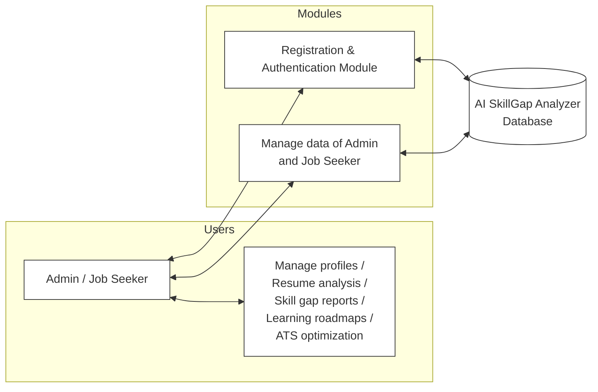

---

## 4.2 DATAFLOW DIAGRAM / CONTEXT DIAGRAM

### Level 0 DFD (Context Diagram)

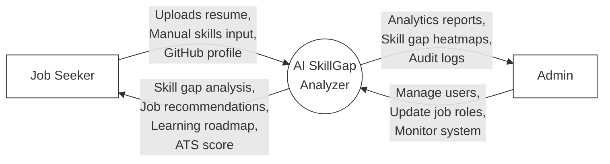

### Level 1 DFD - Admin

```mermaid
graph LR
    %% Nodes
flowchart LR
    Admin["Admin"]
    
    P1(("Admin<br/>Login"))
    D1["User<br/>Database"]
    
    P2(("Manage<br/>Job Roles"))
    D2["Roles<br/>Database"]
    
    P3(("View<br/>Analytics"))
    D3["Analysis<br/>Database"]
    
    Admin -->|Login credentials| P1
    P1 -->|Verified| D1
    D1 -.->|Success| Admin
    
    Admin -->|Add/Edit/Delete roles| P2
    P2 <-->|Update| D2
    
    Admin -->|Request insights| P3
    D3 -->|Skill gap data| P3
    P3 -.->|Charts & reports| Admin

    style Admin fill:#fff,stroke:#000,stroke-width:2px
    style P1 fill:#fff,stroke:#000,stroke-width:1px
    style P2 fill:#fff,stroke:#000,stroke-width:1px
    style P3 fill:#fff,stroke:#000,stroke-width:1px
    style D1 fill:#fff,stroke:#000,stroke-width:1px
    style D2 fill:#fff,stroke:#000,stroke-width:1px
    style D3 fill:#fff,stroke:#000,stroke-width:1px
```

### Level 1 DFD - Job Seeker

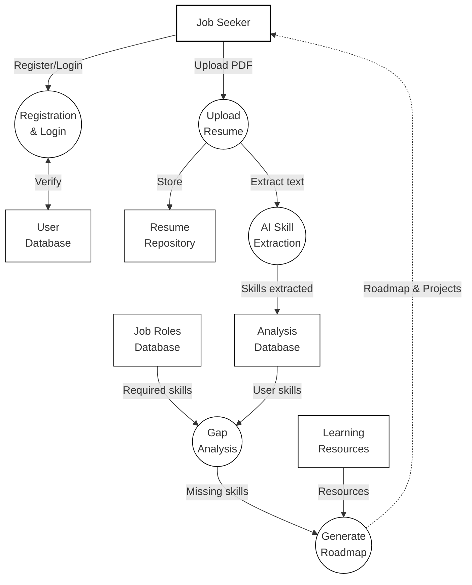

---

## 5.1 USE CASE DIAGRAMS

### Use Case Diagram - Admin

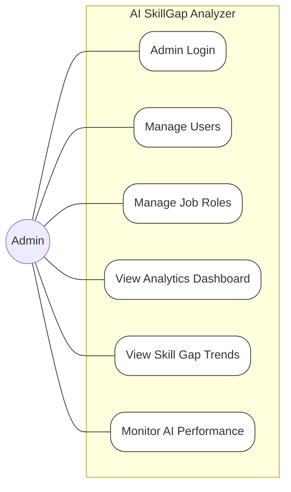

### Use Case Diagram - Job Seeker

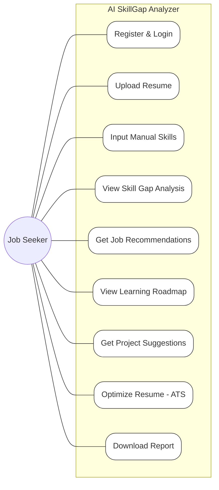

---

## 5.2 SEQUENCE DIAGRAMS

### Sequence Diagram - Job Seeker Analysis Flow

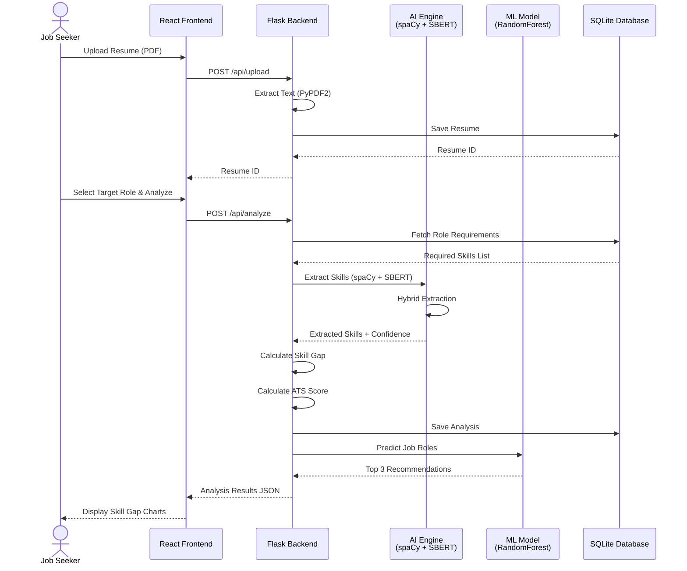

### Sequence Diagram - Admin Role Management

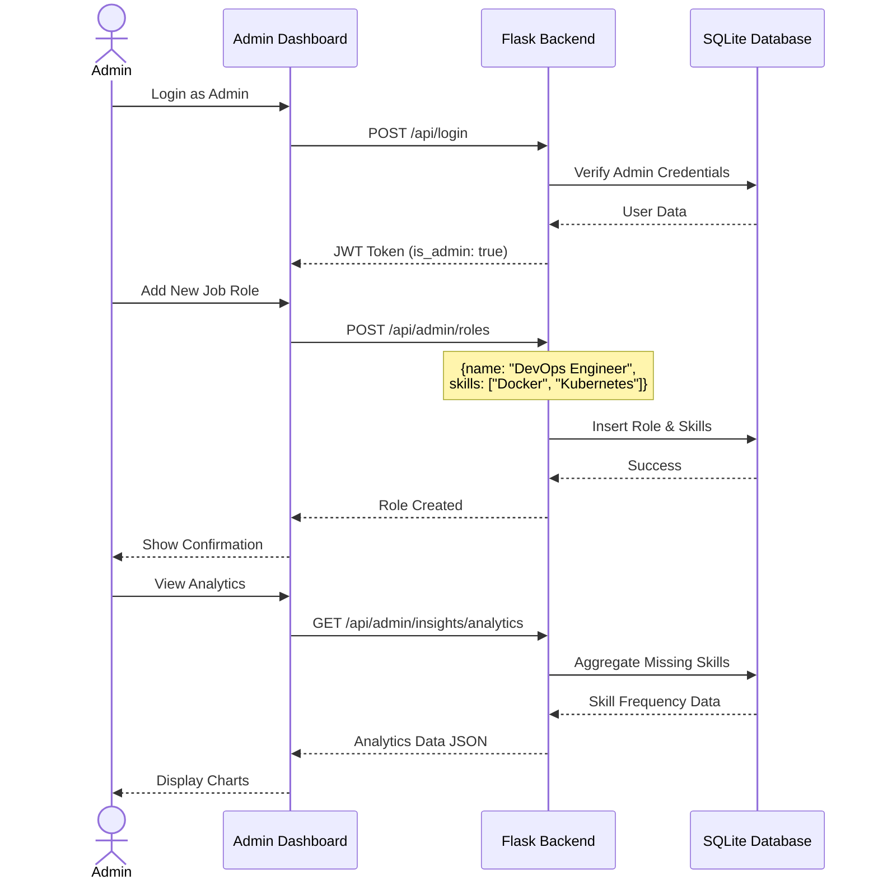

---

## 5.3 ACTIVITY DIAGRAMS

### Activity Diagram - Job Seeker Workflow

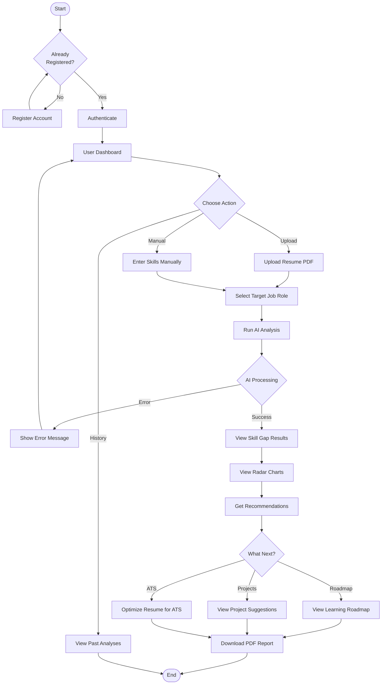

### Activity Diagram - Admin Workflow

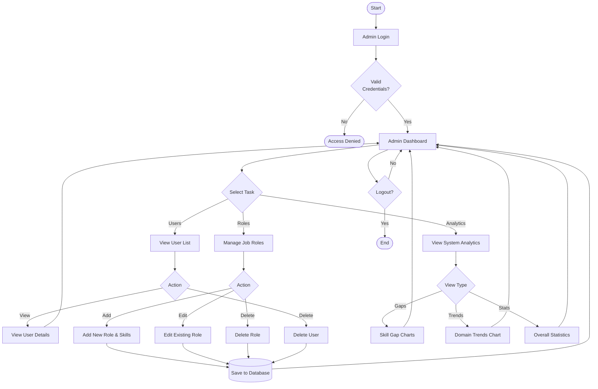

---

## 5.4 DATABASE SCHEMA (ER DIAGRAM)

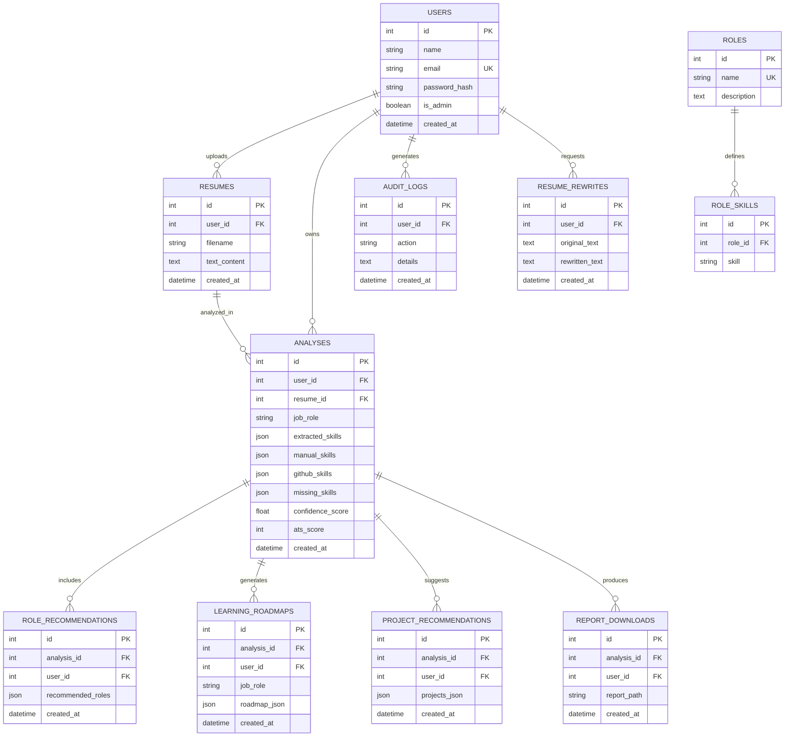

---

## 5.5 TECHNOLOGY STACK OVERVIEW

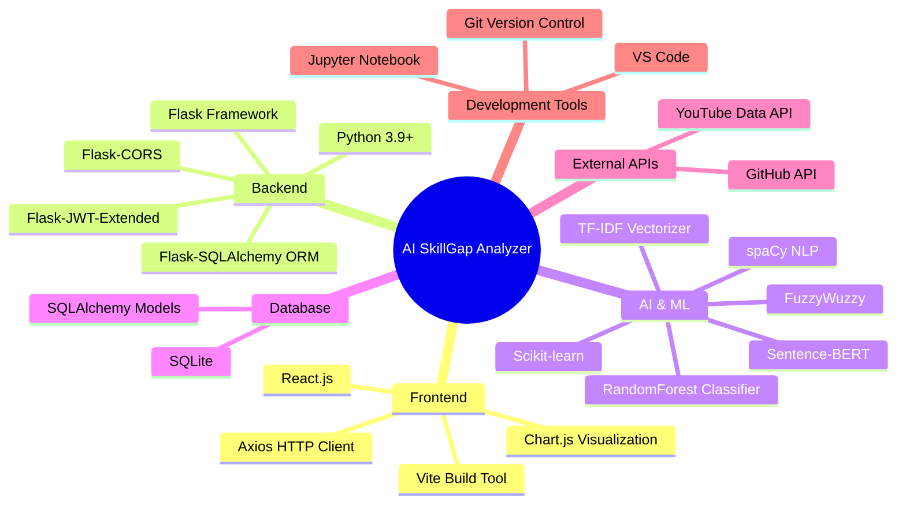

---

## 5.6 DEPLOYMENT ARCHITECTURE

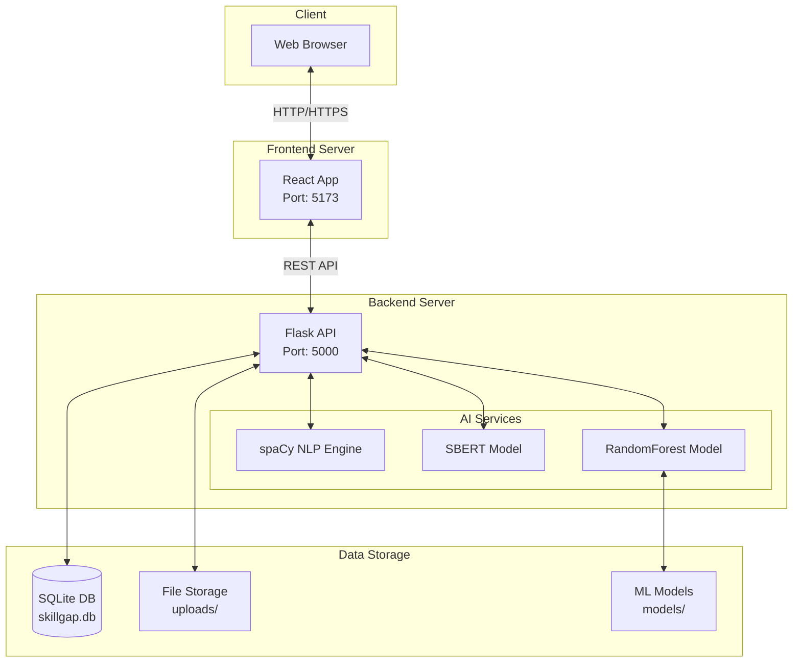
